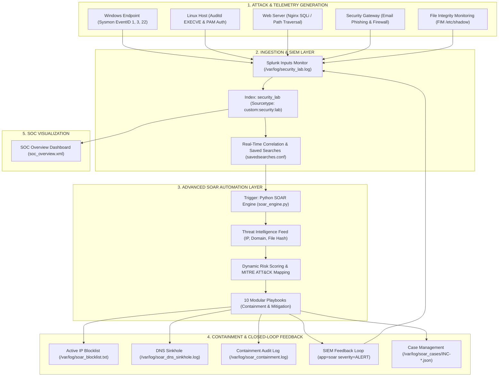

# Enterprise-Style Cybersecurity SOC & SOAR Lab Architecture

---

## 1. Executive Hardware Reality Check & Resource Audit

An enterprise SOC stack is typically distributed across multiple dedicated servers or clustered Kubernetes nodes. Before attempting to deploy enterprise components on a single workstation, a hardware audit was conducted on the host system:

* **Host Machine:** AMD Ryzen 5 5600H with Radeon Graphics
* **CPU Topology:** 6 Physical Cores, 12 Threads (High-performance multi-threaded)
* **Total Host RAM:** 7.1 GiB usable (8 GB physical, ~900 MB reserved for iGPU)
* **Currently Used RAM:** ~4.6 GiB (OS desktop environment, system daemons, Splunk Enterprise)
* **Available / Free RAM:** **~2.5 GiB**
* **Swap Allocation:** 7.3 GiB on NVMe
* **Storage Available:** **106 GiB Free** on NVMe SSD (`/dev/nvme0n1p7`, 23% used)
* **Current Splunk Footprint:** Splunk Enterprise 9.x/10.x running bare metal (`splunkd`, `mongod-8.0` KVStore, `postgres`, `traefik`, `mrsparkle`) consuming **~1.8 - 2.2 GiB RAM**.

> [!CAUTION]
> **Host Memory Constraint:** Attempting to simultaneously run Splunk Enterprise + Splunk SOAR (Phantom) + Wazuh Manager/Indexer + Elasticsearch/Kibana + Windows VM would require **between 48 GB and 64 GB of RAM**.
> On this 8 GB laptop (with 2.5 GB available), starting those heavy Java/JVM/Postgres containers simultaneously will trigger the Linux OOM (Out Of Memory) killer, thrash swap heavily on the NVMe, and lock up the operating system.

---

## 2. Component Feasibility & Resource Allocation Plan

| Component | Minimum RAM | Recommended RAM | CPU Threads | Storage | Recommended on Host? | Optimal Deployment Mode | Architectural Justification |
| :--- | :--- | :--- | :--- | :--- | :--- | :--- | :--- |
| **Splunk Enterprise** | 2.0 GB | 8.0 GB | 2–4 | 10 GB | **YES** | Bare Metal (Active) | Primary enterprise SIEM, indexing, correlation engine, and web dashboard. Already configured and running. |
| **Splunk SOAR (Phantom)** | 8.0 GB | 16.0 GB | 4 | 50 GB | **NO (Simultaneously)** | Dedicated VM (Future hardware) | Phantom requires PostgreSQL, RabbitMQ, Celery, and custom Python environments. Minimum 8 GB RAM by itself would crash the host. |
| **Custom Python SOAR** | 25 MB | 100 MB | 1 | < 100 MB | **YES (Recommended)** | Bare Metal / Script Engine | Zero-overhead, 14-stage lifecycle, 10 playbooks, deterministic sub-second response, direct Splunk API integration. |
| **Wazuh Manager + Indexer**| 4.0 GB | 8.0 GB | 2–4 | 20 GB | **NO (Simultaneously)** | Docker (Sequential Profile) | Wazuh Indexer is OpenSearch (Java JVM heap 2–4GB). Overlaps directly with Splunk's role as an indexer. |
| **Wazuh Agent (HIDS)** | 35 MB | 100 MB | 1 | 500 MB | **YES** | Bare Metal / Docker | Extremely lightweight C agent. Can forward FIM and audit events directly into Splunk or Wazuh. |
| **Elasticsearch** | 2.0 GB | 4.0 GB | 2 | 20 GB | **NO** | Container (Optional) | Redundant. Running Elasticsearch next to Splunk Enterprise is running two competing SIEM indexers. |
| **Kibana** | 1.0 GB | 2.0 GB | 1 | 5 GB | **NO** | Container (Optional) | Splunk Web already provides dashboarding, visualization, and alerting out of the box. |
| **Graylog** | 4.0 GB | 8.0 GB | 2–4 | 20 GB | **NO** | Docker (Sequential) | Requires MongoDB + OpenSearch + Graylog server. Duplicates Splunk SIEM pipeline. |
| **TheHive 5** | 4.0 GB | 8.0 GB | 2 | 15 GB | **NO (Simultaneously)** | Docker (Sequential Profile) | Java/Cassandra backend case management. Python SOAR case manager already handles structured JSON tickets. |
| **Cortex** | 2.0 GB | 4.0 GB | 2 | 10 GB | **NO (Simultaneously)** | Docker (Sequential Profile) | Observable analyzer engine. Overkill when Python Threat Intel feed provides instant offline enrichment. |
| **Windows 10/11 Endpoint VM**| 4.0 GB | 6.0 GB | 2 | 30 GB | **CONDITIONAL** | KVM / VirtualBox (Sequential) | Cannot run concurrently with Splunk on 8GB host. Use for live attack tests when Splunk is paused, or simulate Sysmon. |
| **Kali Attacker / Tester** | Native | Native | Native | Native | **YES (Active)** | Bare Metal (Native OS) | Current host is already a high-performance Linux environment with full pentest and emulation capabilities. |

---

## 3. Technology Evaluation: Platform Overlap & Redundancy

In enterprise engineering, tool selection is dictated by functional necessity rather than collecting logos:

### Why Splunk + Elasticsearch + Graylog should NOT be run simultaneously:
1. **Identical Functional Role:** Splunk Enterprise, Elasticsearch (ELK), and Graylog (OpenSearch-based) all perform the exact same core function: log collection, parsing, indexing, full-text searching, and dashboarding.
2. **Resource Starvation:** Both Elasticsearch and OpenSearch pre-allocate 50% of available system memory to JVM heap (minimum 2 GB – 4 GB). Running two SIEM indexers on an 8 GB laptop guarantees severe memory contention, high page fault rates, and system lockups.
3. **Splunk Enterprise is the Optimal Primary SIEM:** Splunk provides enterprise SPL query syntax, native KVStore, REST API automation, and rich visual dashboards.

### Custom Python SOAR vs. Splunk SOAR (Phantom):

```
┌───────────────────────────────────────┐       ┌───────────────────────────────────────┐
│          CUSTOM PYTHON SOAR           │       │         SPLUNK SOAR (PHANTOM)         │
├───────────────────────────────────────┤       ├───────────────────────────────────────┤
│ • Memory footprint: ~25 MB RAM        │       │ • Memory footprint: 8 GB - 16 GB RAM  │
│ • Startup time: Instant (< 0.1s)      │       │ • Startup time: 3 - 5 minutes         │
│ • Execution: Native Python 3.14       │       │ • Architecture: RabbitMQ, Celery,     │
│ • Transparency: Full code control     │       │   PostgreSQL, Django, VPE Web UI      │
│ • Extensibility: Modular playbooks    │       │ • Playbooks: Visual drag-and-drop     │
│ • Cost & Licensing: Open, zero-cost   │       │ • Licensing: Enterprise / Community   │
└───────────────────────────────────────┘       └───────────────────────────────────────┘
```

**Integration Pattern:** The custom Python SOAR provides production-grade automation logic with zero resource overhead. If Splunk SOAR is deployed in a future high-RAM environment, the custom Python SOAR acts as a specialized edge worker executing custom containment scripts and pushing normalized incident JSON tickets into Phantom via its REST API (`/rest/container` and `/rest/artifact`).

---

## 4. Advanced Multi-Mode Architecture & Profiles

To overcome physical hardware limitations without sacrificing learning depth, the lab operates across **4 Operational Modes** managed by [`soc_mode.sh`](file:///home/pranesh2804/splunk-siem-soar-homelab/soc_mode.sh):

```
                ┌────────────────────────────────────────────────────────┐
                │             OPERATING PROFILE CONTROLLER               │
                │                     soc_mode.sh                        │
                └───────────────────────────┬────────────────────────────┘
                                            │
         ┌───────────────────┬──────────────┴──────┬───────────────────┐
         ▼                   ▼                     ▼                   ▼
   [Profile 1]         [Profile 2]           [Profile 3]         [Profile 4]
   Lightweight          Full SOC               Attack             Incident
    Daily SOC          Enterprise            Simulation           Response
  (~2.0 GB RAM)       (~2.6 GB RAM)         (~1.5 GB RAM)       (~1.8 GB RAM)
  Splunk Core +       Sysmon + Linux        Adversary Emulation  Case Management +
  Base Auth Logs      Audit + FIM + Web     Atomic Red Team +    Forensic Triage +
  + Playbook 1-2      + 10 Playbooks        Hydra / Nmap / C2    Eradication Audit
```

### Profile Commands:
* **Activate Profile 1 (Lightweight Daily SOC):**
  ```bash
  ./soc_mode.sh lightweight
  ```
* **Activate Profile 2 (Full Enterprise SOC):**
  ```bash
  ./soc_mode.sh full
  ```
* **Activate Profile 3 (Attack Simulation Mode):**
  ```bash
  ./soc_mode.sh attack
  ```
* **Activate Profile 4 (Incident Response & Forensics Mode):**
  ```bash
  ./soc_mode.sh ir
  ```
* **Hardware & Service Telemetry Check:**
  ```bash
  ./soc_mode.sh status
  ```
* **Reclaim Host RAM (Stop Resource-Heavy Services):**
  ```bash
  ./soc_mode.sh stop
  ```

---

## 5. End-to-End Enterprise Architecture Dataflow



---

## 6. The 10 Automated SOC Playbooks

All 10 playbooks are implemented in [`soar/soar_engine.py`](file:///home/pranesh2804/splunk-siem-soar-homelab/soar/soar_engine.py):

| # | Playbook Name | Trigger Condition | Indicators Extracted | Threat Intelligence Query | Automated Containment Action | MITRE ATT&CK |
|---|---|---|---|---|---|---|
| **1** | **Brute Force Response** | > 3 authentication failures in 60s | Source IP, Target User | Check IP reputation & velocity | IP added to SOAR blocklist; iptables simulated DROP; account lockout warning | T1110 |
| **2** | **Suspicious Command Response** | Base64 PowerShell or bash download cradle | Process Name, Parent PID, CommandLine | Inspect obfuscated command string | SIGSTOP process isolation; tree snapshot recorded | T1059.001 |
| **3** | **C2 / Network Threat Response** | Outbound traffic on 4444/1337 or beacon cadence | Destination IP, Dest Port | Query C2 IP database | Immediate socket disconnect; IP blocked in perimeter filter | T1071.001 |
| **4** | **Malware Response** | Antivirus detection / known trojan signature | File Path, SHA256 Hash | Query hash reputation & AV ratio | File quarantined to `/var/quarantine/` with `chmod 000`; process killed | T1204.002 |
| **5** | **Privilege Escalation Response** | Unauthorized sudo `/bin/bash` or setuid abuse | Username, Executable, EUID | Policy authorization check | Simulated session kill (`pkill -KILL -u`); sudo privileges suspended | T1548.003 |
| **6** | **Multi-Stage Compromise Response** | Correlation across 2+ attack stages on one host | Hostname, Attacker IP, Target User | Cross-stage correlation verification | Simulated Host Isolation (VLAN quarantine); forensic snapshot triggered | T1021 / T1486 |
| **7** | **Phishing Investigation** | Inbound email with suspicious URL / SPF fail | Embedded Domain, Recipient | WHOIS age & phishing feed | Domain sinkholed to `127.0.0.1`; fleet mailbox purge; password reset flagged | T1566.002 |
| **8** | **Suspicious File Hash Investigation** | Unknown binary execution or suspicious hash | MD5 / SHA256 Hash | VirusTotal / Threat feed lookup | Hash pushed to EDR fleet-wide blacklist; matching files swept | T1027 |
| **9** | **Suspicious Domain Investigation** | High DGA score or newly registered domain | FQDN / Domain | DGA algorithm & WHOIS check | Domain added to DNS RPZ sinkhole; historical DNS logs queried | T1568.002 |
| **10** | **Account Compromise Response** | Impossible travel / anomalous login location | User Account, Origin IP | GeoIP & concurrent session audit | Active OAuth/Kerberos sessions revoked; account locked pending MFA | T1078 |

---

## 7. The 14-Stage Incident Response Lifecycle

Every incident processed by the SOAR engine transitions through a structured 14-phase lifecycle, saving full forensic evidence to `/var/log/soar_cases/INC-<ID>.json`:

```
Phase 01: Detection            ──▶ Alert generated by Splunk correlation rule
Phase 02: Alert Ingestion      ──▶ SOAR engine captures and timestamps alert payload
Phase 03: Triage               ──▶ Categorizes alert severity, target entity, and scope
Phase 04: IOC Extraction       ──▶ Regex parsing of IPs, domains, hashes, and usernames
Phase 05: Threat Intelligence  ──▶ Local Threat Intel DB lookup (reputation, ASN, score)
Phase 06: Risk Scoring         ──▶ Composite scoring algorithm (0 - 100 risk scale)
Phase 07: MITRE Mapping        ──▶ Automatic tagging of MITRE tactic, technique, ID
Phase 08: Incident Creation    ──▶ Formal ticket opened with unique UUID tracking
Phase 09: Investigation        ──▶ Deep telemetry analysis (process tree, DNS, parents)
Phase 10: Containment          ──▶ Non-destructive isolation (firewall drop, sinkhole)
Phase 11: Eradication Sim      ──▶ Root cause remediation (persistence removal, purge)
Phase 12: Recovery Sim         ──▶ System health verification and safe service restore
Phase 13: Lessons Learned      ──▶ Post-incident review, timing metrics, rule tuning
Phase 14: Incident Closure     ──▶ Final ticket signoff and archive in case directory
```

---

## 8. Multi-Source Enterprise Telemetry Matrix

Implemented in [`scripts/advanced_telemetry_generator.py`](file:///home/pranesh2804/splunk-siem-soar-homelab/scripts/advanced_telemetry_generator.py) and ingested via Splunk inputs:

* **Windows Sysmon EventID 1:** Process Creation with obfuscated PowerShell command line executed by Office application.
* **Windows Sysmon EventID 22:** DNS Query to newly registered C2 domain `c2-beacon-malicious.xyz`.
* **Windows Sysmon EventID 3:** Outbound TCP Network Connection to destination port 4444.
* **Windows Security EventID 4625:** Failed logon attempts with SubStatus `0xc000006a` (bad password).
* **Linux auditd:** `EXECVE` records capturing `sudo /bin/bash` privilege escalation.
* **File Integrity Monitoring (FIM):** Alterations to `/etc/shadow` with before/after SHA256 checksums.
* **Web Server Logs:** Nginx access logs containing SQL Injection (`' UNION SELECT`) and Directory Traversal (`../../etc/passwd`).
* **Email Gateway Telemetry:** Inbound spearphishing email with failing SPF/DKIM/DMARC headers.
* **Perimeter Firewall Logs:** Dropped SYN packets on SSH port 22 from internal rogue hosts.
* **Antivirus Detections:** Critical malware execution attempts with SHA256 identification.
