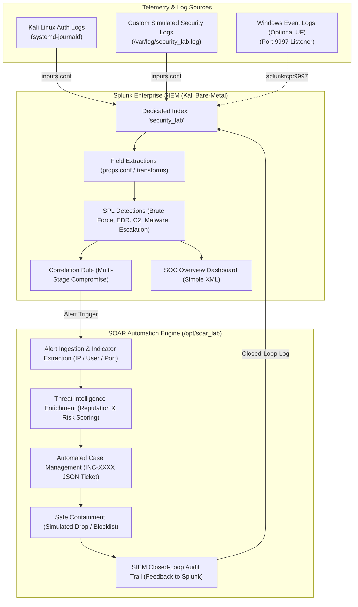

# Splunk SIEM + SOAR Homelab

An end-to-end, production-aligned Cybersecurity Monitoring and Incident Response Homelab deployed on bare-metal **Kali Linux**. 

This project bridges **Security Information & Event Management (SIEM)** with automated **Security Orchestration, Automation, and Response (SOAR)** to demonstrate a closed-loop security operations pipeline: from initial log telemetry to automated threat enrichment and non-destructive incident containment.

---

## 🏗️ Architecture Overview



---

## 💻 Environment Specifications

- **Host OS**: Kali GNU/Linux Rolling (Kernel `7.0.12+kali-amd64`, Bare Metal / Dual-Boot)
- **SIEM Platform**: Splunk Enterprise 10.4.3 (64-bit AMD64)
- **Persistence**: Native `systemd` managed service (`Splunkd.service`)
- **Listening Ports**:
  - `8000`: Splunk Web UI
  - `8089`: Splunk Management REST API
  - `9997`: Splunk Universal Forwarder Receiver
- **SOAR Engine**: Python 3 (Object-Oriented Playbook Engine, Zero External Dependencies)

---

## 🔍 Log Ingestion Pipeline

Modern Kali Linux uses `systemd-journald` rather than legacy `rsyslog`. The lab handles this natively:

1. **System Authentication Logs**:
   - Live journal authentication stream captured to `/var/log/kali_auth.log`.
   - Ingested under sourcetype `linux:auth:journal`.
2. **Security Simulation Logs**:
   - Safe simulated attack telemetry written to `/var/log/security_lab.log`.
   - Ingested under sourcetype `custom:security:lab`.
3. **Windows Log Integration (Dual-Boot Architecture)**:
   - Splunk TCP Receiver on port `9997` is configured and active.
   - When booted into Windows or when forwarding from another network host, the Splunk Universal Forwarder (UF) with `Splunk_TA_windows` forwards Security and System event logs directly to the Kali SIEM.

---

## 🎯 SPL Detections & MITRE ATT&CK Mapping

All detections are defined in `detections/savedsearches.conf`:

| # | Detection Name | MITRE Technique | Detection Logic Summary |
|---|---|---|---|
| **1** | **Failed Login Attempts** | `T1110` (Brute Force) | Captures single authentication failures across PAM and application logs. |
| **2** | **Multiple Failed Logins (Brute Force)** | `T1110.001` (Password Guessing) | Aggregates repeated authentication failures ($\ge 3$) by source IP and user within a defined window. |
| **3** | **Suspicious Command Execution** | `T1059` (Command & Scripting) | Identifies PowerShell flags (`-nop`, `-w hidden`, `-enc`), Base64 patterns, or shell download cradles. |
| **4** | **Suspicious Network Activity** | `T1071` (Application Layer C2) | Detects outbound traffic destined for high-risk ports (`4444`, `1337`) or external C2 IPs. |
| **5** | **Malware Execution Attempt** | `T1204.002` (Malicious File) | Extracts antivirus signatures (e.g. `Trojan.GenericKD`) and targeted file paths from EDR alerts. |
| **6** | **Privileged Account Activity** | `T1548.003` (Sudo / Sudo Caching) | Tracks privilege escalation commands, sudo sessions, and root transitions. |

### 🔗 Correlation Rule: Multi-Stage Potential Compromise
A single failed login or isolated warning does not warrant an outage; however, **multiple failed logins followed immediately by suspicious commands or malware execution on the same host** represents a confirmed compromise chain.

**SPL Logic:**
```spl
index=security_lab 
| eval attack_stage = case(
    like(message, "%Failed login%"), "Stage 1: Failed Logins",
    like(message, "%powershell%") OR like(message, "%outbound connection%") OR like(message, "%Malware%"), "Stage 2: Suspicious Activity",
    1=1, "Other"
) 
| where attack_stage != "Other" 
| stats dc(attack_stage) as distinct_stages, 
        values(attack_stage) as stages_observed, 
        values(message) as attack_evidence, 
        earliest(_time) as start_time, 
        latest(_time) as end_time by host 
| where distinct_stages >= 2 
| eval incident_name = "Potential Host Compromise: Multiple Attack Stages Observed on " . host 
| eval duration_minutes = round((end_time - start_time) / 60, 2) 
| table incident_name, host, stages_observed, duration_minutes, attack_evidence
```

---

## 📊 SOC Dashboard (`dashboards/soc_overview.xml`)

Deployed natively into Splunk Web with global permissions and embedded into the top navigation bar of the **Search & Reporting** app:

- **Key Metrics (KPIs)**: Total Security Events, Failed Logins, Suspicious Activity, Malware Detections, Privileged Activity.
- **Visual Analytics**:
  - Event Severity Breakdown (Pie Chart: `CRITICAL`, `ALERT`, `WARNING`, `INFO`).
  - Event Velocity Over Time (Stacked Column Chart by Application Component).
- **Investigation Tables**:
  - Top Source IPs with observed telemetry samples.
  - Real-time Security Event Stream.

---

## ⚡ SOAR Engine & Automated Playbook (`soar/soar_engine.py`)

### Realistic Engineering Assessment
Enterprise **Splunk SOAR** (Phantom) requires a minimum of **16–32 GB RAM** on RHEL. On a dual-boot laptop with 7.1 GB RAM, running full Splunk SOAR alongside Splunk Enterprise is neither viable nor necessary for educational homelab mastery.

Instead, this project implements a **dedicated, production-patterned SOAR Engine in Python** that executes a complete 5-stage incident response playbook:

1. **Indicator Extraction**: Parses raw event text to extract source IPs, target users, and ports.
2. **Threat Intelligence Enrichment**:
   - Checks IP categorization (RFC 1918 Private vs Public/Test-Net).
   - Queries threat intelligence feed for reputation, threat score (0–100), threat category (e.g., C2, Brute Force), and threat actor.
3. **Automated Case Management**:
   - Generates an auditable JSON ticket in `/var/log/soar_cases/` (e.g. `INC-20260910125511-88704B.json`).
4. **Safe Controlled Response**:
   - High-risk indicators ($\ge 75$) are contained via non-destructive methods: added to active blocklist (`/var/log/soar_blocklist.txt`) and recorded in the containment log (`/var/log/soar_containment.log`).
5. **SIEM Feedback Loop**:
   - Emits an incident resolution event back into `/var/log/security_lab.log` under `app=soar`, which Splunk ingests in real-time, closing the loop.

---

## 📁 Repository Structure

```text
splunk-siem-soar-homelab/
├── README.md                          # Comprehensive Lab Documentation
├── .gitignore                         # Protects credentials, logs, and sensitive data
├── configs/
│   ├── inputs.conf                    # Splunk log inputs & receiver configurations
│   └── props.conf                     # Search-time field extraction rules
├── dashboards/
│   └── soc_overview.xml               # Splunk SOC Overview Dashboard (Simple XML)
├── detections/
│   └── savedsearches.conf             # SPL detections, alerts, and correlation rules
├── logs/
│   └── sample_security_lab.log        # Sample simulated attack log telemetry
└── soar/
    ├── soar_engine.py                 # Automated Python SOAR playbook engine
    └── sample_incident_ticket.json    # Example incident ticket generated by SOAR
```

---

## 🚀 Quickstart & Verification

1. **Verify Splunk Service**:
   ```bash
   sudo systemctl status Splunkd
   ```
2. **Access Splunk Web**:
   Open browser at [http://127.0.0.1:8000](http://127.0.0.1:8000) and log in with your admin credentials.
3. **View SOC Dashboard**:
   Navigate to **Search & Reporting** $\rightarrow$ Click **"SOC Dashboard"** in the top navigation bar.
4. **Execute SOAR Playbook**:
   ```bash
   python3 soar/soar_engine.py "Suspicious Outbound Connection" "198.51.100.45" "root" "Suspicious outbound connection detected to 198.51.100.45:4444"
   ```
5. **Verify Incident Ticket**:
   ```bash
   cat /var/log/soar_cases/INC-*.json
   ```

---

## 📄 Resume & Interview Points

- **Resume Bullet**: *Deployed Splunk Enterprise 10.4 on bare-metal Kali Linux; engineered 6 custom SPL detections and correlation rules for brute-force attacks, living-off-the-land execution, and outbound C2 beacons.*
- **Resume Bullet**: *Built a Python-based SOAR automation pipeline integrating threat intelligence enrichment, automated case ticketing, and safe containment with a closed-loop audit trail back into the SIEM.*
- **Interview Highlight**: *Explain how the multi-stage correlation rule reduces alert fatigue by linking preceding authentication failures with secondary post-exploitation artifacts before elevating priority.*
